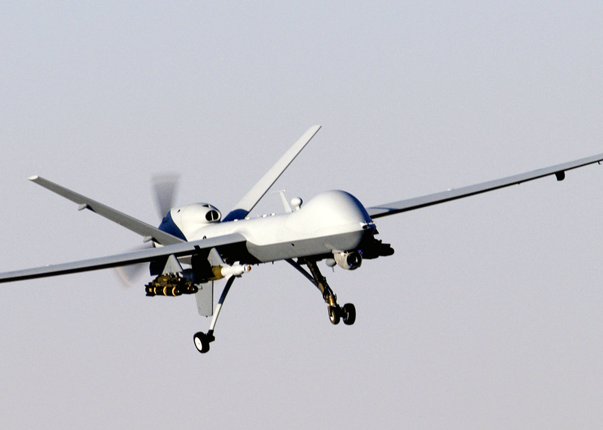

# I. The Question

**Status:** Draft 2026-09-09 (non-normative prose).

## At what clock speed does control become ceremonial?

Not "will machines fight" - they already do, weekly, on video. The
question is narrower and harder: which human, with what authority, can
still say no, how fast, and what happens when the answer arrives after
the strike?

Three slides, and only three. **In the loop:** the human decides each
release; the machine executes. **On the loop:** the machine nominates,
the human approves - a recruit in a dugout at 05:00 pressing red on a
dinky screen for the tenth time that night. **Told afterwards:** the
machine releases, the human reads the log. Everything in this book is
an attempt to date, per rung and per system, which slide we are on -
because doctrine claims the first, practice lives in the second, and
the third arrives without announcement.

## What this book will not do

Stated here, absolute, before any facts: no tactics, techniques, or
procedures. No build guides, no procurement how-tos, no targeting
detail, no frequencies, no code. The weekly footage from Ukraine makes
this constraint load-bearing rather than decorative - the systems are
visible, the components are commercial, and a book that teaches would
be a manual with a thesis stapled on. Institutional facts (who fields
what, when, under whose authority) and governance criteria (what gate,
owned by whom, verified how). A paragraph that helps an operator press
an accelerator gets cut no matter how true it is. See CONTRIBUTING.md
Rule 2 - the one rule in either book that is not up for debate.
