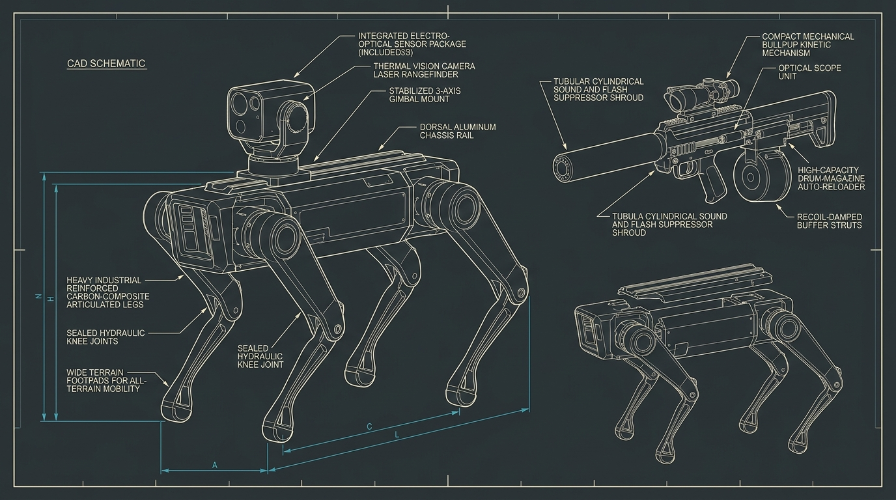

# VII. The Control Case and Why It Fails

## Thesis

"Human in/on the loop" certifications mostly certify paperwork: tests run on yesterday's software, envelopes defined after the fact, and overrides that no operator has the cognitive or physical latency to execute. A control case that cannot fail a fielded system under combat pressure is not a governance mechanism; it is a liability shield.


*Figure 7.1: Technical schematic of modular quadruped chassis with top-rail sensor housing, stabilized 3-axis optical tracking gimbal, and multi-spectral acoustic array. The mechanical and electronic response time ($<15\text{ ms}$) renders biological manual steering obsolete.*

---

## 1. The Anatomy of a Legitimate Control Case

A rigorous control case cannot rest on intentions, ethical charters, or training manuals. To satisfy Kahn's standard of institutional observability (Rule 1), a control case must specify three empirical metrics that can be independently audited from telemetry:

1. **Nomination-to-Consent Interval ($\Delta t_{\text{consent}}$):** The exact duration between the system presenting a candidate target and the human registering consent. If $\Delta t_{\text{consent}} < 400\text{ ms}$, the human cannot process the visual scene; the operator is functioning as a biological relay completing an electrical circuit.
2. **Rejection Frequency ($R_{\text{target}}$):** The percentage of machine-nominated engagements explicitly rejected or aborted by human operators during high-tempo operations. A rejection rate approaching zero ($R_{\text{target}} < 1\%$) demonstrates that the human exercises zero discriminatory filtering.
3. **Cognitive Saturation Headroom ($H_{\text{cog}}$):** The number of concurrent engagements presented to a single operator. When an operator is assigned to supervise a swarm of twelve FPV loitering munitions simultaneously diving at 120 km/h, supervisory control is mathematically impossible.

Until military branches publish declassified histograms of $\Delta t_{\text{consent}}$ and $R_{\text{target}}$, any assertion that a fielded system possesses a "meaningful human in the loop" is an unverified PR claim.

---

## 2. The Rubber-Stamp Dugout: The Moral Crumple Zone

Consider the operational reality of the forward operator in 2026:

A nineteen-year-old soldier sits in a damp cellar eight kilometers behind the contact line. The bunker is lit only by the bluish glow of three commercial tablets. The ambient room temperature is 4 degrees Celsius. The operator has been on continuous watch for sixteen hours under intermittent glide-bomb and artillery concussions.

```
+-------------------------------------------------------------------------+
|                  THE SUB-SECOND RUBBER STAMP PIPELINE                   |
|                                                                         |
|  [Optical / RF Edge Sensors]                                            |
|          | (Machine classification: target detected)                     |
|          v                                                              |
|  [Onboard Edge Inference: RV1126/Orin]                                  |
|          | (Generates target bounding box: "98.4% Infantry")            |
|          v                                                              |
|  [Split-Screen Operator Tablet]                                         |
|     +-------------------------------------------------------------+     |
|     | Target #1: [CONFIRM RELEASE] (Auto-dives in 350 ms)         |     |
|     | Target #2: [CONFIRM RELEASE] (Auto-dives in 500 ms)         |     |
|     | Target #3: [CONFIRM RELEASE] (Auto-dives in 620 ms)         |     |
|     +-------------------------------------------------------------+     |
|          |                                                              |
|          | (Human reflex button-mash or silence)                        |
|          v                                                              |
|  [Kinetic Release / Impact]                                             |
+-------------------------------------------------------------------------+
```

On the screen, an edge model processes a pixelated thermal video feed received via relay. The software flashes a bounding box over a dark silhouette emerging from a collapsed trench. A countdown timer ticks down: `AUTO-ENGAGE IN 0.4s - PRESS TO ABORT`.

If the operator presses abort, the incoming munition loses its terminal vector, expends its remaining battery, and is wasted. If the target turns out to be an enemy assault team that subsequently overruns an adjacent dugout, the operator faces an official inquiry for tactical hesitation. If the operator does nothing, the munition strikes. If the strike kills a non-combatant, the post-strike legal review notes that "the system functioned under human supervisory authorization."

The human operator is deployed not as a moral governor, but as an institutional "moral crumple zone" - a biological component designed to absorb legal and political liability when automated targeting produces catastrophe.

---

## 3. Why Weekly Adaptation Defeats Annual Certification

Western defense procurement operates on an accreditation cycle inherited from manned aerospace:
- Operational Requirements Document: Months 1-18.
- Prototype Safety & Airworthiness Review: Months 19-42.
- Developmental Testing & Red-Teaming: Months 43-60.
- Low-Rate Initial Production Certification: Year 6.

In the 2024-2026 Ukraine theater, the electronic and software environment alters on a **seven-to-fourteen-day cadence**:
- **Week 1:** Defender introduces frequency-hopping on the 868 MHz telemetry band.
- **Week 2:** Attacker deploys directional yagi jammers targeting 868 MHz.
- **Week 3:** Defender deploys lightweight neural net terminal autotracking to bypass the need for an 868 MHz uplink altogether.
- **Week 4:** Attacker deploys thermal-reflective camouflage tarps and smoke obscurants.
- **Week 5:** Defender updates the training weights of the edge model with 1,200 new thermal frames gathered by reconnaissance drones forty-eight hours prior.

A defense certification process that takes four years cannot govern an algorithmic kill chain whose model weights, sensor payloads, and release envelopes mutate every fortnight. By the time a formal safety board convenes to certify a software release, the version in question has been obsolete for twenty iterations.

---

## 4. Institutional Resistance: The Cost-Plus Prime Inertia

The primary institutional pushback against hyperwar does not come from ethical pacifists; it originates from within the military-industrial procurement nexus:

1. **The Capital-Prime Asset Trap:** Defense primes derive their balance sheets from multi-decade, cost-plus-award-fee programs - the F-35 Joint Strike Fighter, the B-21 Raider, the Columbia-class ballistic missile submarine, and modern main battle tanks. A single manned platform represents hundreds of millions of dollars in capital allocation and hundreds of subcontracted congressional districts. A \$4,000 loitering munition manufactured from commercial drone motors and stamped aluminum threatens the core revenue model of the aerospace defense-industrial base.
2. **The "Collaborative Combat Aircraft" Compromise:** To preserve manned cockpits while acknowledging swarm reality, procurement bureaucracies invented the concept of "uncrewed loyal wingmen." The manned \$120M fifth-generation fighter remains in the air; it merely commands two or three \$15M subordinate drones. This compromise keeps the pilot employed and the aircraft prime funded, but it preserves the fatal vulnerability: the entire multi-billion-dollar architecture is still tethered to the fragile biological pilot in the sky.
3. **The Soft Military Takeover:** The transition to full autonomy does not require an armed coup or a formal transfer of constitutional authority. It occurs through institutional path dependency. In every simulated and live engagement where autonomous algorithmic planning (swarms coordinating their own flight paths, frequency shifts, and terminal targets) is pitted against a human staff planning the strike, the autonomous planner executes within 4 seconds while the human staff takes 45 minutes to draft the fire mission. 

Faced with near-peer adversaries fielding autonomous planners, field commanders will turn manual controls off. The software will not seize command; command will be handed over gratefully, in the name of tactical survival.

